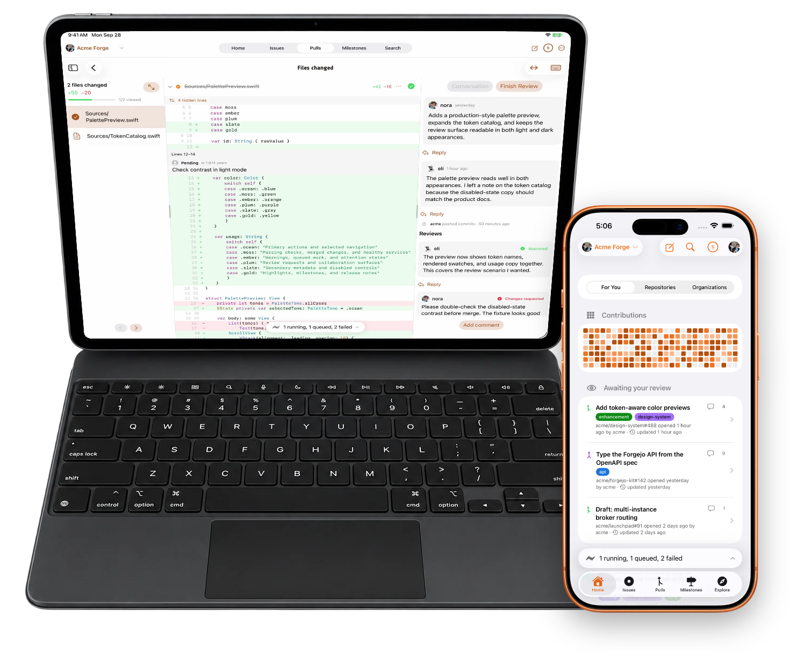

<p align="center">
  <picture>
    <source media="(prefers-color-scheme: dark)" srcset="docs/images/fjord-mark-dark.svg">
    
  </picture>
</p>

<h1 align="center">Fjord</h1>

<p align="center">
  Native clients for Forgejo and compatible Git forges, including Gitea.<br>
  Connect them to the server and account you already have. Fjord is not a GitHub client.
</p>

<p align="center">
  <a href="https://fjord.sh/?utm_source=github&amp;utm_medium=referral&amp;utm_campaign=fjord-clients">fjord.sh</a> ·
  <a href="https://mobile.fjord.sh/mobile?utm_source=github&amp;utm_medium=referral&amp;utm_campaign=fjord-clients">Fjord Mobile</a> ·
  <a href="https://cli.fjord.sh/cli?utm_source=github&amp;utm_medium=referral&amp;utm_campaign=fjord-clients">fj CLI</a> ·
  <a href="https://docs.fjord.sh/?utm_source=github&amp;utm_medium=referral&amp;utm_campaign=fjord-clients">Docs</a>
</p>

---

## Get Fjord

| Client | Availability | Get it |
| --- | --- | --- |
| **Fjord Mobile** for iPhone and iPad | On the App Store. Free, with an optional one-time Mobile Pro purchase. | <a href="https://apps.apple.com/app/apple-store/id6774756338?pt=128751142&amp;ct=gh-readme-01&amp;mt=8"></a> |
| **Fjord Mobile** for Android | On Google Play for phones, tablets, foldables, and Chromebooks. Free, with an optional one-time Mobile Pro purchase. | <a href="https://play.google.com/store/apps/details?id=com.rasterstate.fjord&amp;referrer=utm_source%3Dgithub%26utm_medium%3Dreferral%26utm_campaign%3Dgh-readme-01"></a> |
| **fj CLI** | Available today for macOS and Linux. Free and open source. | [Install with Homebrew](#fj-cli) |

You need a forge to connect to: your own Forgejo server, or one someone runs for you. If you want one, [fjord.sh](https://fjord.sh/?utm_source=github&utm_medium=referral&utm_campaign=fjord-clients) offers managed Forgejo hosting.

## Fjord Mobile

Your self-hosted Git forge on iPhone, iPad, and Android. Review pull requests, triage issues, watch your CI, and merge, from anywhere.

<p align="center">
  
</p>

- **Review pull requests.** Conversation, diffs, changed files, and CI status. Approve, request changes, and merge.
- **Work your issues.** Open pull requests, create and edit issues, comment, label, and assign.
- **Run CI, not just watch it.** Browse Actions runs, read a failed job's log, and start a run.
- **Read and fix code.** Browse repositories, commits, branches, and releases. Edit a file and commit it to a branch for a quick fix.
- **Stay current.** A notification inbox, optional push, and Home Screen widgets.

Sign in to your own Forgejo or Gitea server with a personal access token. No Fjord account is required. Add several servers and accounts and switch between them without signing out. Tokens stay on the device: in the Keychain on iPhone and iPad, encrypted with the Android Keystore on Android. Signing in with a Fjord account adds push notifications.

**Free:** browse, review, comment on, and merge pull requests. Actions and their logs, push notifications, the contribution widget, reading pull requests offline, and a few offline reviews are free as well.

**Mobile Pro** is an optional one-time purchase, bought separately on the App Store and on Google Play. It adds the Review Queue (the pull requests waiting on your review, one at a time), Needs You on Home and in a widget, multi-line comments, commenting in the review workstation on iPad and Android tablets, more offline reviews, notification actions, and an on-device review assistant where Apple Intelligence or Gemini Nano is available. On iPhone and iPad it also adds Live Activities for runs and Siri; on Android you follow and cancel a run from its notification.

Requires iOS 17.4 or later, or Android 8.0 or later. The two apps are released separately, with their own version numbers. More at [mobile.fjord.sh](https://mobile.fjord.sh/mobile?utm_source=github&utm_medium=referral&utm_campaign=fjord-clients).

## fj CLI

A command-line tool for Forgejo, in the spirit of GitHub's `gh`. Repositories, issues, pull requests, releases, and Actions from one signed, native binary.

```sh
brew tap rasterstate/tap https://rasterhub.com/rasterstate/homebrew-tap && brew install fj
```

Homebrew covers macOS and Linux x86_64. Other install routes are at [cli.fjord.sh](https://cli.fjord.sh/cli?utm_source=github&utm_medium=referral&utm_campaign=fjord-clients).

<p align="center">
  
</p>

```sh
fj auth login            # authenticate against a Forgejo host
fj repo clone owner/name # clone a repository
fj pr create             # open a pull request from the current branch
fj pr list               # list pull requests for the current repo
fj run watch             # stream the latest Actions run's logs
fj api /user             # make a raw authenticated API request
```

- **Knows where you are.** Inside a clone, fj infers the repository and host from your git remote.
- **Works across hosts.** Sign in to several forges and move between them.
- **Built for scripts.** `--json` on list and view commands, `--json-fields` to pick fields, and `fj api` for everything else.
- **Careful with tokens.** Tokens go to your OS keychain, with a `0600` file fallback on hosts that have none.

fj is open source under the MIT license. Its source and releases are at [rasterhub.com/rasterstate/fj](https://rasterhub.com/rasterstate/fj).

## Works with

| Client | Forges |
| --- | --- |
| Fjord Mobile for iPhone and iPad | Forgejo 7 and newer, and Gitea servers. Actions runs need Forgejo 15; job logs, cancelling a run, and artifacts need Forgejo 16. Comments on a range of lines need Forgejo 16 and are not available on Gitea. |
| Fjord Mobile for Android | Forgejo and Gitea servers. Comments on a range of lines need Forgejo 16. |
| fj CLI | Built against the Forgejo 7 API and tested on Forgejo 7.0. Newer versions are expected to work, and Gitea 1.21 mostly works. See the [compatibility notes](https://rasterhub.com/rasterstate/fj/src/branch/main/docs/compatibility.md). |

## About this repository

This repository holds product information and public feedback for the Fjord clients. It is not the product source.

- The Fjord Mobile source is not published.
- The fj source and its issue tracker are public at [rasterhub.com/rasterstate/fj](https://rasterhub.com/rasterstate/fj).
- Corrections to the documentation here are welcome as pull requests.

## Feedback

Found a bug or want something added? [Open an issue](https://github.com/rasterandstate/fjord/issues/new/choose) and pick the form for your client.

Issues here are public. Remove access tokens, private server URLs, and private repository names from anything you post.

Fjord Mobile is developed in a private tracker and fj on rasterhub, so here is what the labels on your issue mean:

| Label | Meaning |
| --- | --- |
| `needs-info` | We asked for more detail and are waiting on you. |
| `tracked` | Accepted and being worked on. The issue stays open until the fix is released. |
| `fixed-in-release` | The fix is publicly available. The closing comment names the version. |
| `not-planned` | Closed without a change. The closing comment says why. |

Security problems should be reported privately. See [SECURITY.md](SECURITY.md).

---

<p align="center">
  A <a href="https://rasterstate.com/?utm_source=github&amp;utm_medium=referral&amp;utm_campaign=fjord-clients">Raster &amp; State</a> project. © 2026 Raster &amp; State LLC.
</p>

<p align="center">
  <sub>
    Nothing in this repository grants a license to the Fjord client software or to the Fjord and Raster &amp; State names and marks.<br>
    Fjord is a third-party client. It is not affiliated with, endorsed by, or sponsored by Forgejo, Codeberg, Gitea, or any server operator.
  </sub>
</p>
